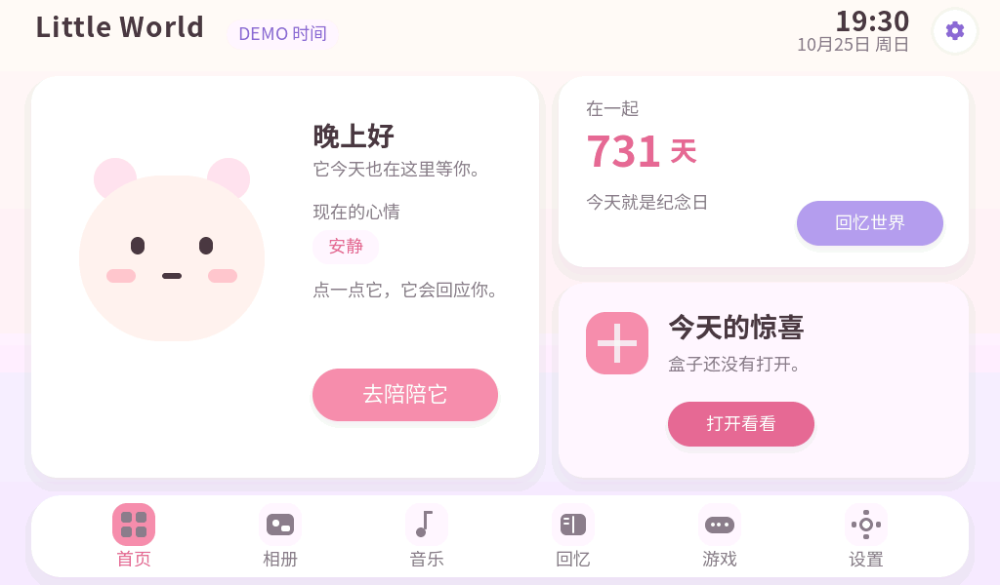
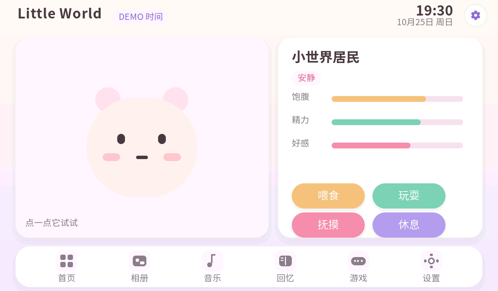
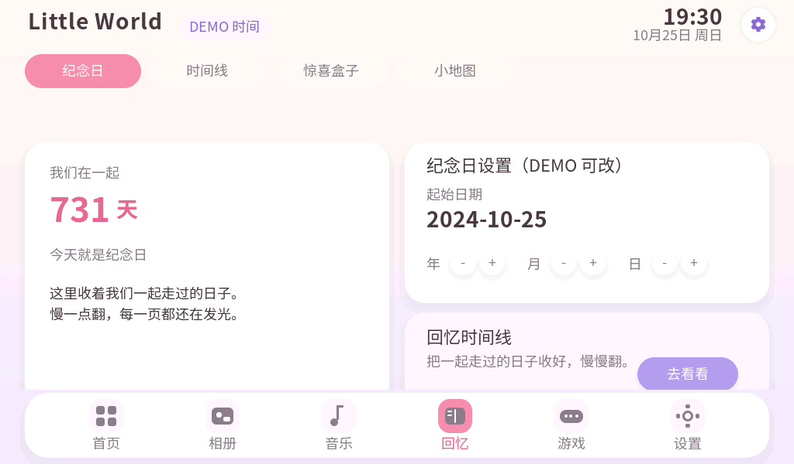
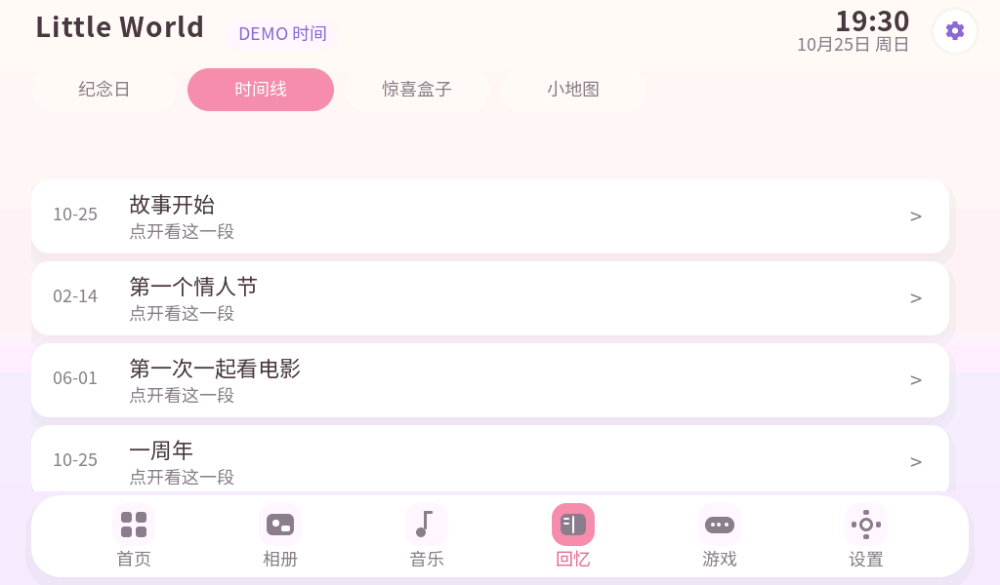
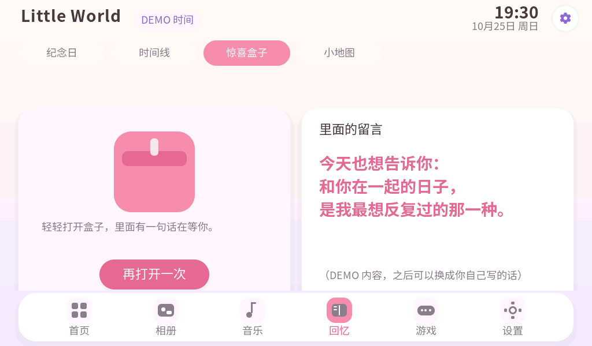
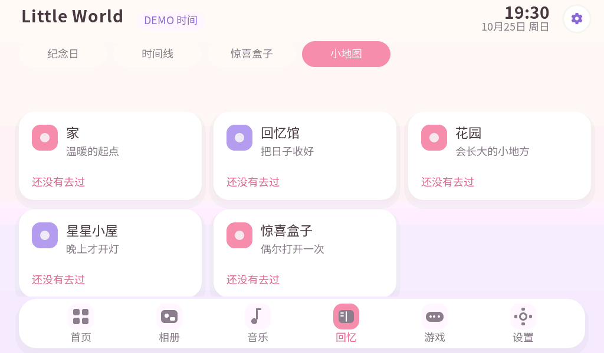
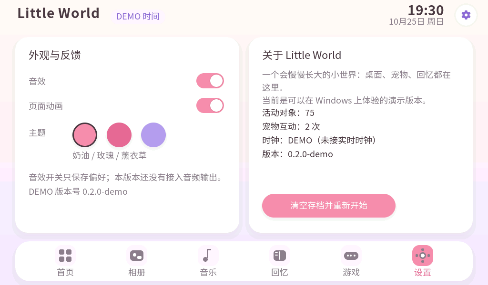
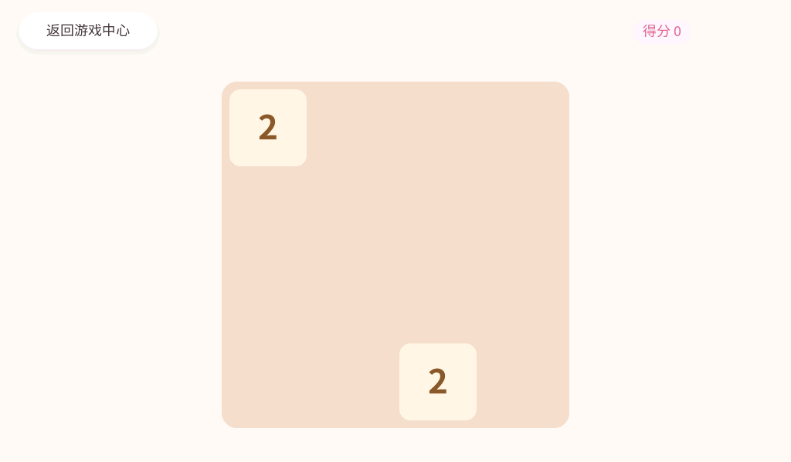
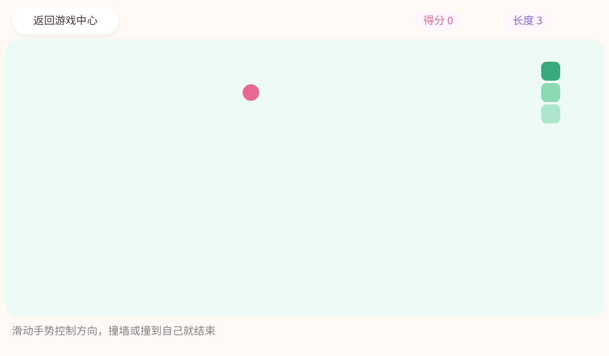
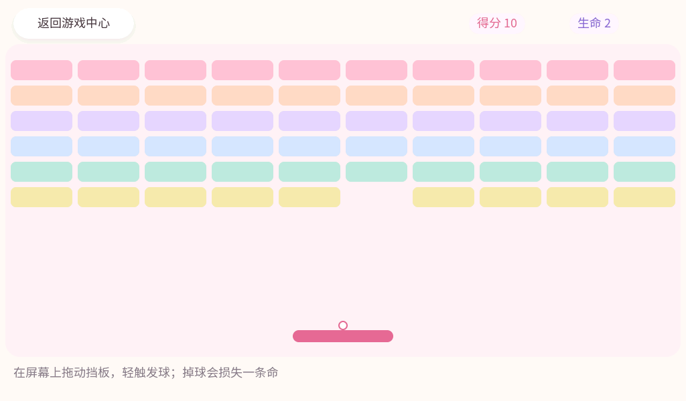

# MORNING REPORT — Little World 夜间开发

日期：2026-10-25 凌晨。开发者：DSH。工作区：`D:\LittleWorld-Main-DSH`。

> 一句话：**现在双击 `Start-LittleWorld.bat` 就能在 Windows 上打开 Little World，点宠物、看纪念日、
> 翻时间线、开惊喜盒子、改设置；同一套 UI 代码也能编译成 ESP32-P4 固件（未上板）。**

---

## 0. 修复轮记录（2026-10-25 上午，对应 ChatGPT 的审查意见）

四个被点名的缺陷都改在代码里，并用无头交互回归重新走了一遍：

| # | 问题 | 修复 | 证据 |
|---|---|---|---|
| 1 | 相册大图弹窗的"上一张/下一张/关闭"没有绑定事件 | `lw_app_album.c` 增加 viewer 状态与三个回调，按钮真正可用，关闭会删除遮罩 | `22-album-viewer` → `23-album-next`（标题变成"生日 2/6"）→ `24-album-closed`（回到网格） |
| 2 | 修改纪念日日期后当前页不刷新 | `adjust_date()` 改为就地 `switch_tab(0)` 重建，而不是 `lw_shell_open()`（当前 app 会提前返回） | `28-date-plus`：2024-10-25 → 2025-10-25，天数 731 → 366 |
| 3 | 音乐切歌后标题/歌手/播放列表高亮不同步 | 标题、歌手、三行列表的控件指针全部保存，`refresh()` 统一刷新文本与高亮；列表行可点击选歌 | `25-music-next`、`26-music-row`（第三行高亮、时长变 3:12）、`27-music-playing` |
| 4 | 设置里的"页面动画"开关不生效 | `lw_theme_enter_anim()` 先读 `settings.animations`，关闭时直接显示不播动画 | `21-settings-anim-off` 之后所有页面切换都走无动画分支 |
| 5 | 其他页面是否有同样的无效按钮/关不掉的遮罩 | 审计了首页、宠物、回忆四页、相册、音乐、设置、小游戏：时间线详情、地点详情、小游戏结算面板的关闭/重开都正常；顺手把设置的两行做成整行可点（点文字也能拨开关） | 见下方回归步骤 |

另外：

- 新增 `LICENSE`（MIT + 第三方声明：LVGL MIT、BSP Apache-2.0、Noto Sans SC OFL）。
- 自动回归从 17 步扩到 40+ 步，覆盖：打开/关闭相册弹窗、上一张/下一张、音乐切歌与列表点选、播放开始、改日期→离开→回来（验证 NVS/文件存档）、开关页面动画。
- 结果：`AUTO RUN: PASSED (0 failure(s))`，活动对象 **84 → 84**，共 **29 张截图**。
---

## 1. 成果摘要

| 部分 | 状态 | 说明 |
|---|---|---|
| Little World 桌面系统 | **通过** | 1024×600 桌面、顶栏（时间/DEMO 标记/设置）、6 项 Dock、页面切换动画、三套主题 |
| 可互动电子宠物 | **通过** | 6 种情绪、点击/抚摸/喂食/玩耍/休息、呼吸+眨眼+情绪姿态、状态持久化 |
| 恋爱纪念世界 | **通过** | 在一起天数、下一个纪念日、日期可编辑、时间线、惊喜盒子、5 地点小地图 |
| 设置 | **通过** | 音效/动画开关、主题切换、诊断信息、清空存档 |
| 相册 | **部分完成** | 数据模型 + 6 张 DEMO 占位图 + 大图浮层；真实照片解码未做 |
| 音乐播放器 | **部分完成** | 播放列表、播放/暂停、进度、音量（持久化）；**没有音频输出** |
| Arcade 接入 | **通过** | 游戏中心 + 2048 / 贪吃蛇 / 打砖块 三款全屏可玩，可重开、可回游戏中心 |
| Windows 演示程序 | **通过** | 真实窗口、鼠标即触摸、F12 截图；无头 `--auto` 回归模式 |
| 自动测试 | **通过** | 142 项核心单元测试；29 张截图的交互回归，10 次往返对象数 84→84 |
| ESP-IDF 固件编译 | **通过** | esp32p4 / rev3_x / 32 MB；app 1,199,920 B，镜像头 v3.0–v3.99 |
| 实板运行 / 触摸 / 帧率 / NVS | **未开始** | 今晚没有连接开发板，按你的要求完全没碰设备 |

---

## 2. 可运行入口

| 内容 | 位置 |
|---|---|
| **一键启动** | 双击 `D:\LittleWorld-Main-DSH\Start-LittleWorld.bat` |
| 可执行文件 | `D:\LittleWorld-Main-DSH\build\host\LittleWorld.exe` |
| 重新构建 | `pwsh -NoProfile -ExecutionPolicy Bypass -File tools\build_demo.ps1 -Run` |
| 截图目录 | `D:\LittleWorld-Main-DSH\reports\screenshots\`（29 张 PNG） |
| 固件产物 | `D:\LittleWorld-Main-DSH\build\little_world.bin`（+ `bootloader/`、`partition_table/`） |
| 源码 | `D:\LittleWorld-Main-DSH\firmware\components\lw_core`、`lw_ui`、`arcade_core`；Windows 端在 `host/` |
| 交接说明 | `CODEX_HANDOFF.md` |

操作：鼠标左键 = 手指点击；按住拖动 = 滑动；`Esc` 退出；`F12` 截图到 `%LOCALAPPDATA%\LittleWorld\`。
存档也在该目录（`littleworld.bin`），删掉即恢复初始状态，或在设置页点“清空存档并重新开始”。

---

## 3. 页面截图（全部来自实际运行）

| 桌面主页 | 宠物（可互动） |
|---|---|
|  |  |

| 纪念日 | 回忆时间线 |
|---|---|
|  |  |

| 惊喜盒子（打开后） | 小地图 |
|---|---|
|  |  |

| 设置 | 2048 |
|---|---|
|  |  |

| 贪吃蛇（滑动手势） | 打砖块（拖动挡板） |
|---|---|
|  |  |

其余：`03-pet-fed`、`04-pet-playing`、`07-surprise`、`10-place`（地点详情）、`11-album`、`12-music`、
`13-arcade`、`16-home-again`、`18-breakout-ready`、`20-after-cycles`、`21-settings-anim-off`、`22-album-viewer`、`23-album-next`、`24-album-closed`、`25-music-next`、`26-music-row`、`27-music-playing`、`28-date-plus`、`29-date-persisted`。

---

## 4. 测试结果

### 4.1 核心单元测试（真实执行）

```
pwsh -NoProfile -ExecutionPolicy Bypass -File tools\run_host_tests.ps1
142 checks, 0 failure(s)
HOST TESTS PASSED
```

覆盖：闰年/跨年/1970 基准日期往返、纪念日下一次与倒计时、宠物衰减与睡眠恢复、情绪优先级、
喂食上限、精力不足拒绝玩耍、超长离线封顶、存档编解码往返、CRC-32 已知答案、坏字节/坏魔数/坏长度/
坏版本全部拒绝、DEMO 回忆数据合法性。

### 4.2 交互回归（无头，真实 UI）

```
build\host\LittleWorld.exe --auto reports\screenshots
AUTO RUN: PASSED (0 failure(s))
objects: 84 -> 84   （29 张截图）
```

自动走完：首页 → 宠物（喂食、玩耍）→ 首页 → 纪念日 → 时间线 → 惊喜盒子（打开）→ 小地图 → 地点详情
→ 相册 → 音乐 → 游戏 → 2048 → 设置 → 首页，并在最后做 10 次“进宠物页面再回首页”的往返，统计活动
LVGL 对象数不变（84 → 84）。

### 4.3 固件编译与镜像

```
little_world.bin        1,199,920 B   sha256 bbc7a27c...f426fbb
bootloader.bin             22,016 B   sha256 276f331b...9e3ae8
partition-table.bin         3,072 B   sha256 84040236...828fc6

chip: esp32p4    chip revision: v3.0 (300) .. v3.99 (399)    flash: 32MB
partition: nvs 0x9000/0x6000, phy_init 0xF000/0x1000, factory 0x10000/0x600000, storage 0x610000/0x400000
```

实板 silicon v3.2 = 302，落在 `[300, 399]` 内 → 修订检查通过。
**这只是编译与离线镜像检查，不是实板运行。**

### 4.4 已知 Bug / 限制

1. 小游戏三款都已接入（2048 / 贪吃蛇 / 打砖块），但难度与手感还没调过，也没有暂停键（只能返回游戏中心）。
2. 相册、音乐是 DEMO：没有真实图片解码、没有音频输出；“音效”开关只持久化偏好。
3. 固件端存储已接 NVS（设置、宠物、纪念日都会持久化）；但板子**没有 RTC**，`get_time` 仍返回 false，
   所以固件会用 DEMO 时钟（界面右上角标 `DEMO 时间`）。接 Wi-Fi 校时或 RTC 是下一步。
4. 设置里的“页面动画”开关已持久化，但页面切换动画还没有读它。
5. 音乐页的“♪”已改为用图元绘制（字体子集里没有该字形，之前会显示方框）。

### 4.5 尚未测试（必须上板才知道）

屏幕方向与触摸坐标、实际帧率、内存占用与长时间稳定、宠物状态断电恢复、字体在实屏上的可读性。

---

## 5. Git 提交

仓库：`D:\LittleWorld-Main-DSH`，已推送到 **https://github.com/Start66613/littleworld**（public，`main` 分支）。

```
6ee9185  feat(shell): Little World desktop shell with dock, theme and app registry
（本次报告与交接文档为第二个提交）
```

---

## 6. 下一步建议（按影响排序）

1. **上板验证**：刷入 `build/little_world.bin`（需要你明确授权；出厂固件备份在
   `D:\Espressif\LittleWorld\private\backups\LittleWorld\20261025-005021`，已验证）。
2. 固件端接时间源（Wi-Fi 校时或 RTC），让日期不再是 DEMO 值；存储已经走 NVS。
3. 给三款小游戏加暂停键与难度曲线，并把最高分写进游戏中心卡片。
4. 相册接 SD 卡与图片解码；音乐接板载 ES8311（BSP 已提供 codec 接口）。
5. 让“页面动画”开关真正控制 `lw_theme_enter_anim`。

---

## 7. 与 Codex 的交接

见 `CODEX_HANDOFF.md`：架构入口、模块关系、主要接口、构建方法、已完成内容、已知问题、
尚需实板验证清单、以及合并回正式工程 `C:\Projects\LittleWorld` 的建议顺序。

---

## 8. 边界声明

- 本工作区**没有修改** `C:\Projects\LittleWorld`，也没有修改 `D:\LittleWorld-Arcade`（只复制了其中的
  `arcade_core`，MIT）。
- 今晚**没有**打开串口、没有刷机、没有读写 Flash、没有动 eFuse/C6。
- 所有“通过”都对应真实执行过的命令与产物；未执行的项目在表中写的是“未开始/部分完成”。
---

## 7. 实板验证（2026-10-25 11:20 起，开发板已连接）

刷机：`esptool --chip esp32p4 -p COM5 -b 460800 write_flash 0x10000 little_world.bin`，写入 1,199,920 B，**Hash of data verified**。

启动日志（串口 115200，节选）：

```
I (906) app_init: Project name:     little_world
I (936) efuse_init: Min chip rev:     v3.0
I (940) efuse_init: Max chip rev:     v3.99
I (940) efuse_init: Chip rev:         v3.2
I (1066) ESP32_P4_EV: Install EK79007 LCD control panel
I (1244) ESP32_P4_EV: Display initialized
I (1260) ESP32_P4_EV: Touch 0x5d found
I (1296) esp_lvgl:adapter: LVGL task started successfully
I (1301) ESP32_P4_EV: Setting LCD backlight: 100%
I (1339) littleworld: boot: Little World ready, free heap 29017551 B
```

结论：

| 项目 | 结果 |
|---|---|
| 启动 / 分区 / 镜像头 | 正常，chip rev v3.2 落在 [3.0, 3.99] |
| 显示 | 正常，1024×600，方向正确，能看到 Little World 首页 |
| 触摸 | **初版反向**：`mirror_x=1, mirror_y=1` 导致点左响应右、点上响应下；改成 `0/0` 后"指哪打哪" |
| 背光 | 亮；但日志有 `W ledc: GPIO 32 is not usable`，亮度调节（PWM）大概率不可用，暂按"常亮 100%"记 |
| 运行稳定性 | 连续 60 秒串口无 panic / 无重启 / 无 LVGL 报错 |

已知硬件侧限制：

1. `ledc` 无法占用 GPIO 32（BSP 定义的背光脚），因此 `bsp_display_brightness_set()` 不生效；屏幕保持常亮。
2. GT911 触摸在 IRQ 模式下未启用（BSP 默认轮询），单点触摸可用。
### 7.1 上板后才暴露的两个真 Bug（已修、已复刷）

| # | 现象 | 根因 | 修复 |
|---|---|---|---|
| 1 | 触摸左右上下全反，点左响应右 | `ROTATE_180` 已由适配器作用到触摸，代码里又加了 `mirror_x=1, mirror_y=1`，等于翻了两次 | 两个 mirror 改 0；复测"指哪打哪" |
| 2 | 宠物一启动就饿到 0（饱腹/精力/好感全 0） | `lw_app_state_init()` 在无 RTC 时用 `1700000000`（2023-11）作默认时间，而 UI 用的是 2026-10-25 的 DEMO 基准，第一次 tick 算出约 2.9 年间隔，直接把数值衰减到 0 | 初始化改用同一个 `LW_DEMO_BASE`，并置 `demo_clock=1` |

修复后重新刷机并擦除一次 NVS（仅我们的存档区 0x9000–0xF000），10 秒后的自动存档读回结果：

```
blob copies: 2   crc: OK
sound=1 anim=1 theme=0 demo_clock=1
pet: fullness=72 energy=68 affection=60 sleeping=0 mood=0
last_update=1792956610  born_at=1792956600      (两者只差 10 秒，与 DEMO 基准一致)
anniversary=2024-10-25  volume=60
```

结论：**设备端存档链路真实可用**（NVS 写入 → 72 字节 blob → CRC 校验通过 → 重启后由 `lw_save_decode` 读回）。
