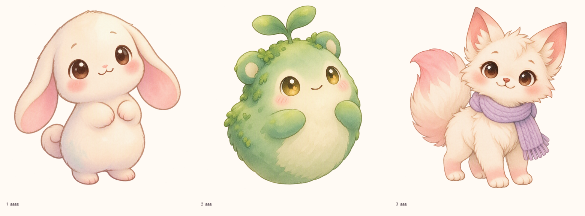
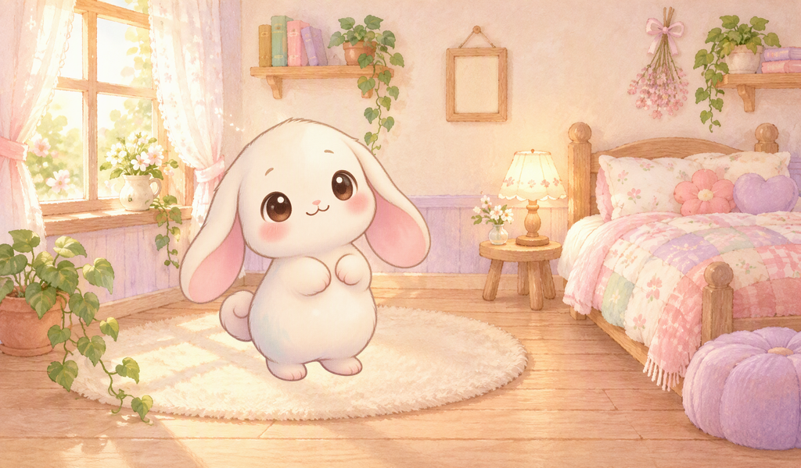

# Little World 2.0 — Batch 1 视觉探索

第一批 Meowa 生成的宠物角色与小房间静态素材，用于确定美术方向。
**选型通过后再进入表情与动画阶段。**

预览先看这两张：

| | |
|---|---|
|  |  |

## 内容

```
characters/
  A1_cream_mochi/    master.png (2048², 透明) + preview-1024.png
  A2_moss_sprite/    master.png (2048², 透明) + preview-1024.png
  A3_scarf_foxcat/   master.png (2048², 透明) + preview-1024.png
rooms/
  B_room_v1/         master.png (2048×1152) + preview-1024.png
home/
  C_home_v1/         master.png (2048×1152) + preview-1024.png   首页氛围参考
previews/
  contact_characters.png      三只角色对比
  mock_home_1024x600.png      角色 + 房间合成，最接近成品观感
manifest.json                 清单：job_id / 积分 / sha256 / 锚点 / 用途
ASSET_REPORT.md               质量检查与推荐
ART_CONTRACT.md               尺寸、配色、命名、验收规范
```

## 成本

5 张图，**56 积分**（预算 100）：
A1 10 + A2 10 + A3 10 + 房间 12（含 1 张参考图）+ 首页 14（含 2 张参考图）。

## 集成提示（给 Codex）

- 角色是 2048² 透明 PNG，直接缩到目标尺寸即可；锚点见 `manifest.json` 的 `anchor`。
- 房间是 2048×1152，对应 1024×600 内容区；中左地毯区留空约 40%，角色站位建议 `x≈0.38·W, feet≈0.83·H`。
- 首页参考图里的空白面板**只是构图示意**，不要抠出来当 UI；卡片、顶栏、Dock 都用 LVGL 画。
- 图中没有任何文字，所有文案由 LVGL 运行时渲染。
