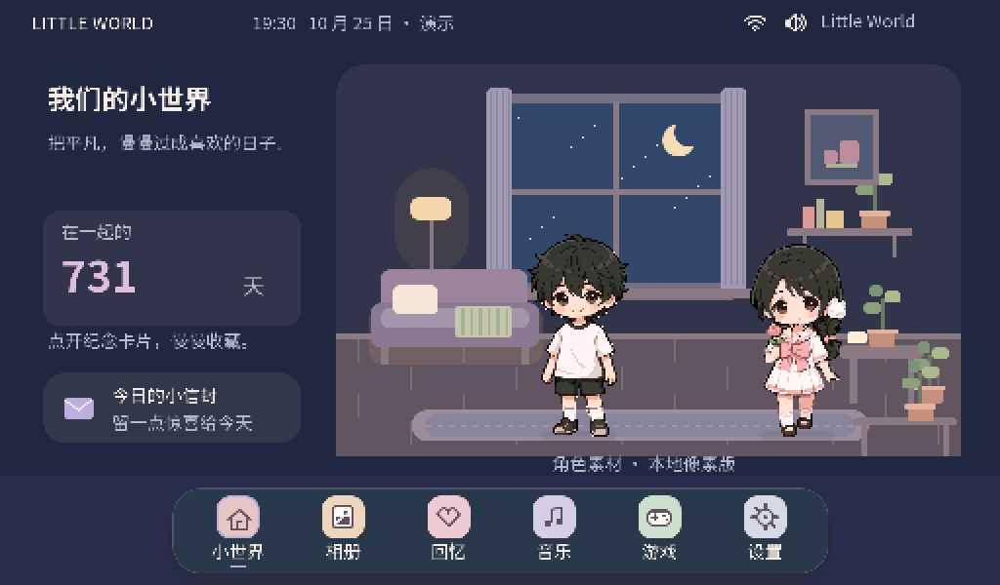

# OS V3.1 交付报告（DSH 侧 → Codex 协同）

写于 2026-10-26 凌晨。这一轮的目标只有一句话：**把 OS V3 从"能启动的原型"推到"板子上真的能看、能信"的第一版**。
现在 P4 实板上已经跑起来带真实角色的系统，不是 Windows 模拟器截图。



---

## 1. 交付坐标

| 项 | 值 |
|---|---|
| 仓库 | `github.com/Start66613/littleworld`（PUBLIC） |
| 分支 | `release/os-v3.1-stable` |
| 提交 | `7fbf877` → 上一提交 `2032906`（本分支基线来自 `agent/os-v2-experience-v3` 17c1545 与 `integration/p4-connectivity-services` 904d7bc 的合并） |
| 应用镜像 | `firmware/build/os/little_world.bin`，2,249,088 B，sha256 `ef5202c965bc23db2cf2d870ed60f29abfa056f2b0f597c5e1aa94ab4cc66be2` |
| 分区占用 | factory 6,291,456 B → **35.7%**；`nvs 0x9000 0x6000`、`phy_init 0xf000`、`storage 4M` 均未改动 |
| 角色包 | `firmware/main/art/characters.lwfa`，572,960 B，sha256 `05499d0cf82b918df8f05b1c3815d5a674d2f332cc39601b81eb93e33174b118` |

---

## 2. 这一轮改了什么

### 2.1 角色上屏（`lw_ui`）

| 文件 | 改动 |
|---|---|
| `firmware/components/lw_ui/src/lw_char_pack.c` | 新增：解析 `.lwfa` 角色包并注册到 `lw_assets`，产出 `lw_actor_art_t[2]` |
| `firmware/components/lw_ui/include/lw_char_pack.h` | 新增：`lw_char_pack_register/blob/art/release` |
| `firmware/main/art/characters.lwfa` | 新增：男性 1 帧 + 千千 8 帧 idle，随固件内嵌在 rodata |
| `firmware/main/lw_boot.c` | 启动时注册角色包，把 `lw_actor_art_t[2]` 传给 `lw_os_start()` |

`.lwfa` 格式（小端，32 字节定长记录，**不要在别处手改**）：

```
header  'LWFA0001' 8B, u16 version=1, u16 clip_count, u32 blob_size
record  char[12] name, u16 frames, u16 w, u16 h, i16 anchor_x, i16 anchor_y,
        u8 loop, u8 reserved, u16 duration_ms, u16 reserved2, u32 data_offset
data    每帧 RGB565(w*h*2, 小端) 紧跟 A8 alpha(w*h)，未预乘
```

当前包内容：`male` 108×212、锚点 (54,209)、1 帧 500 ms；`qianqian` 104×202、锚点 (51,199)、8 帧 125 ms、loop。
生成器：`tools/build_character_pack.py`（输入 `assets/characters/male/male-anchor-aligned.png` 与 `private/pixel-duo/qianqian/frames/idle/frame_XXX.rgb565a8`）。
校验器：`tools/validate_character_pack.py`。

### 2.2 板端证据链（新能力）

| 文件 | 说明 |
|---|---|
| `firmware/main/lw_capture.c/.h` | 串口控制台：`shot [scale]` 输出 base64 BMP、`tap x y` 注入点击、`status`；快照走 `lv_snapshot_take`，必须在 LVGL 任务上下文加锁执行 |
| `firmware/main/lw_boot.c` | 控制台任务与 LVGL 锁桥接（含 `lv_async_call` 点击注入） |
| `tools/board_shot.ps1` | 主机侧收集器：按行号索引重发缺行，校验长度/尾部 |
| `tools/flash_v3.ps1` | 烧写脚本（`-Probe` 只读探测 / `-Authorized` 才真正写） |

协议：设备逐行输出 `LCAP <seq> <total> <base64>`，主机 `pass 1` 收完后按行号补齐缺失行，拼装 BMP。

### 2.3 字体

`tools/gen_fonts.ps1`：44/88 px 改为**显式符号集**（ASCII 32..126 + `·×°℃…`），18/22/28 仍全量扫描源码。
原因：44/88 只需数字和单位，全量扫描会把 2 MB 字库撑爆 Flash。
当前覆盖率：18/22/28 各 665 码位，44/88 各 100 码位，`tools/audit_font_coverage.py` 全 OK。

---

## 3. 板端实测结果（有证据的）

| 项 | 结果 | 证据 |
|---|---|---|
| 启动 | 无 panic，`littleworld: boot: Little World ready`，堆 31.8 MB | `reports/logs/serial-*.log` |
| 两个角色上屏 | 男性 + 千千都在桌面房间里，像素 1× 对齐、脚底落在 y=446 | `reports/board/02-desktop-art-2x.png` |
| 千千 idle 动画 | 8 帧 125 ms 循环，串口采样帧号 `0→6→0→3→5→0→2→4→7→1` | 串口 `LWOS` 采样（诊断构建，已从源码移除） |
| 纪念日天数 | `731 天`（2024-10-25 → 2026-10-25，与 Windows 一致），NVS 读写链路通 | 同上截图 |
| 截图管线 | 512×300 每帧 460,854 B，`pass 1: 6601/6601 lines, 0 missing` | `tools/board_shot.ps1` 输出 |
| Windows 回归 | System 22 / Duo 82 / RPG 85 / Storage 33 / OS V2 340 checks，0 failures，句柄 58→58 | `windows_regression2.log` |

---

## 4. 板端暴露并修掉的 4 个缺陷

| # | 现象 | 根因 | 修法 |
|---|---|---|---|
| 1 | 启动即 panic，蓝屏循环重启（`Load access fault`，MEPC 落在 `strcmp`） | `lw_assets_register()` 只保存调用方指针（`lw_assets.c:34 s_specs=specs`），角色包却传了**函数栈上的** `specs[]`，返回后注册表悬空 | 改为文件级静态数组 `s_specs`；**后续任何注册都必须保证 spec 数组与 id 字符串生命周期 ≥ 注册表** |
| 2 | 角色完全不显示，桌面写着"当前为 TEST A" | clip 名注册成 `male`/`qianqian`，而 `lw_os` 按 `"idle"` 查表（`lw_os.c:181 art_clip`），永远返回 NULL；那行文案是写死的占位串 | clip 名统一注册为 `idle`；文案改为"角色素材 · 本地像素版" |
| 3 | 首页显示"在一起的 740312 天" | `lw_app_state_init()` 只在旧 shell（`lw_ui.c:9`）里调用，OS 桌面路径 `lw_os_start()` 从未初始化 → 纪念日读到 `{0,0,0}` | `lw_os_start()` 开头补 `lw_app_state_init()`（幂等） |
| 4 | 截图 BMP 被截断（453,606 B vs 头部 460,854 B）；早期还有控制台任务栈溢出 panic | base64 尾部未 flush + 控制台任务栈过小 | 改为按行号索引的 `LCAP` 协议重发缺行；控制台任务栈独立加大 |

---

## 5. 给 Codex 的接口约定（改代码前请先确认这几条）

1. **资产注册表只存指针**：`lw_assets_register()` 不拷贝 `specs`，也不拷贝 `id` 字符串。调用方必须保证两者静态存活，直到 `lw_assets_register(NULL,0,...)`。
2. **角色 clip 名固定为 `idle`**：`lw_os` 的 `art_clip()` 用 `"idle"` / `"walk_<dir>"` / `"sleep_idle"` 查表。想加动画请按这个命名扩展，不要改 `lw_actor_art_t` 结构。
3. **`lw_os_start()` 现在会初始化存档状态**：它会调 `lw_app_state_init()`（读过 NVS、可能写回默认值）。如果你在别处提前 init 也不会重复执行。
4. **存档格式没动**：prefs 24 B、RPG 40 B、宠物 72 B 全部保持原样，NVS 不清空（`0x9000` 不要擦）。
5. **截图必须在 LVGL 锁内**：`lv_snapshot_take()` 走软件渲染器，会临时占一大块堆（本次实测峰值 589,824 B），别在无锁上下文调用。
6. **串口控制台**：`shot [1|2]`、`tap x y`、`status`。调试日志请走 `ESP_LOGI`，不要长期占用 stdout（`LCAP` 协议独占 stdout）。

---

## 6. 仍未验证 / 未完成（不要在报告里写成"已完成"）

- **亮度滑杆**：`lw_system_bsp.c:5` 的 `bsp_display_brightness_set()` 路径已接确认，但板端滑动的实际观感**没有测**；旧板子还出现过 `ledc: GPIO 32 is not usable`，本轮日志已无该告警，仍需目视确认。
- **Wi-Fi**：模型层（BFS/状态机/代次隔离/重连策略）有 188 项主机测试，但**射频从未对着 C6 跑过**；OS 页面目前是"模拟网络"。
- **SNTP**：仍是显式 Unsupported（`LW_NET_HAVE_SNTP` 未编译进镜像），系统时间走 demo 时钟。
- **音频**：ES8311 探测与音量通路存在，但没有 PCM 源，**"能出声"未证明**。
- **交互**：`tap` 注入的点击链路已在代码里，但本轮没做逐页点击验收（宠物页、Wi-Fi 页、相册、音乐、设置）。
- **重启不丢档**：本轮只验证了首次启动读到正确天数，没做"改设置 → 重启 → 复核"。
- **三配置构建**：`os` 已构建+烧写，`legacy` / `noaudio` 本轮**未重跑**（上次是 5 天前的结果）。

---

## 7. 复现步骤

```powershell
# 构建（os 单配置）
cd D:\LittleWorld-V3
powershell -NoProfile -ExecutionPolicy Bypass -Command "& '.\tools\build_v3_all.ps1' -Configs 'os'"

# 只读探测（不写 Flash）
powershell -NoProfile -ExecutionPolicy Bypass -File .\tools\flash_v3.ps1 -Port COM5 -Probe

# 烧写（需显式 -Authorized）
powershell -NoProfile -ExecutionPolicy Bypass -File .\tools\flash_v3.ps1 -Port COM5 -Authorized

# 抓图（控制台 115200，2 倍降采样）
powershell -NoProfile -ExecutionPolicy Bypass -File .\tools\board_shot.ps1 -Port COM5 -Baud 115200 -Out .\reports\board\xx.bmp
```

---

## 8. 下一步分工建议

| 谁 | 事项 |
|---|---|
| Codex | OS 页面里对 `lw_os_capabilities_t` 的消费（Wi-Fi/音频/存储三态显示）、亮度滑杆 UI 反馈、宠物页与主页数据绑定 |
| DSH | 亮度/点击/重启保档的板端验收；`legacy`+`noaudio` 重建；全分辨率截图核字体；烧写前检查清单 |
| 共同 | Wi-Fi 真机联调（需要 C6 与单独授权），SNTP 真实异步等待，音频 PCM 源选型 |

---

*本文件随 `release/os-v3.1-stable` 分支提交，任何与本轮实物不符的描述都应被视为 bug，请直接开 issue 指出。*
