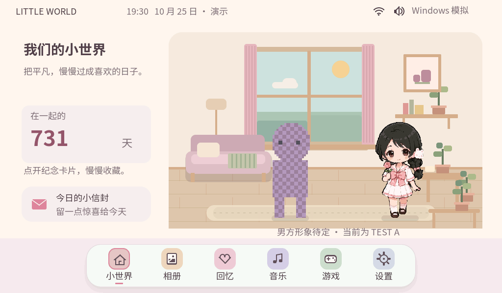
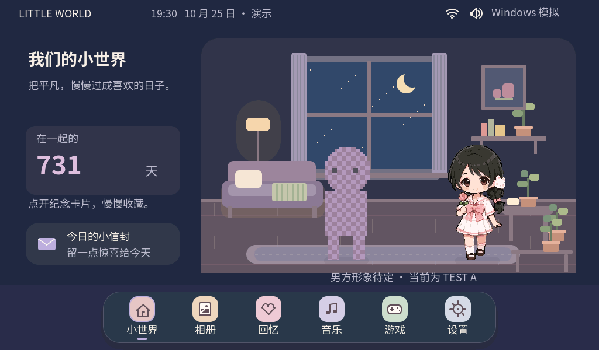
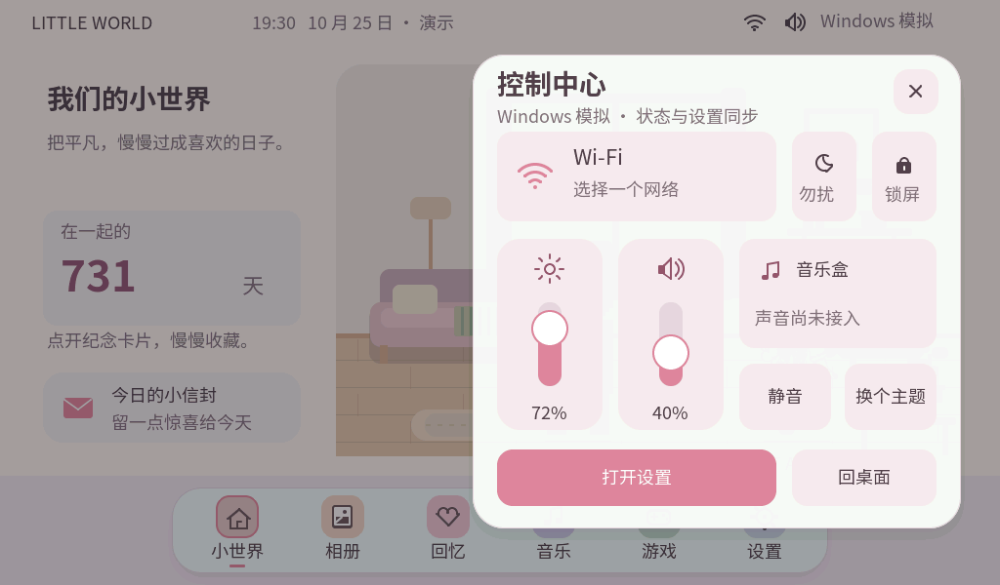
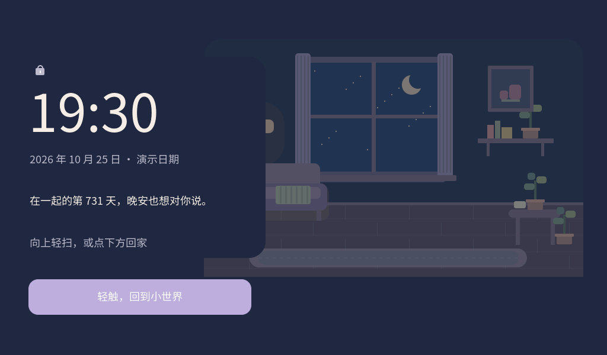
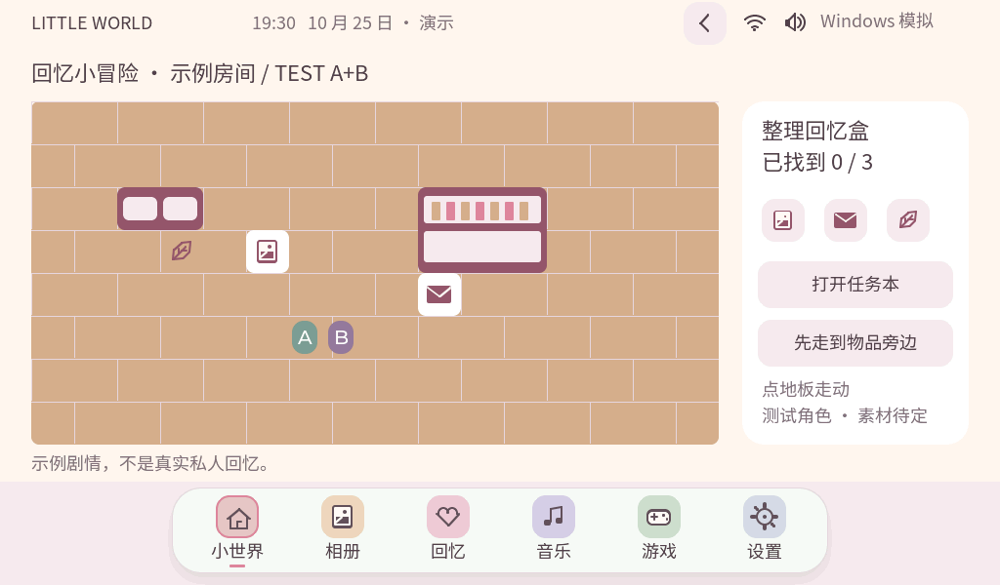

# P5 真实 LVGL 截图

经用户追加授权公开本轮 31 张 PNG，全部为 Windows LVGL 的 1024×600 帧缓冲截图。被测源码 `bc9f2b59d672bec63beacca4c7ced9570746c58d`；含/缺角色资源各 340 项检查通过。图片校验值见 [SCREENSHOTS.json](../SCREENSHOTS.json)。

男方仍标记 TEST A，RPG 使用 A/B 测试角色；音乐为模拟播放。相册读取失败和服务不可用的图片用于展示已通过测试的错误/降级处理。正式美术仍待用户验收。

## 主要页面

## 全部截图

- [01-desktop.png](01-desktop.png)
- [02-control-center.png](02-control-center.png)
- [03-wifi-list.png](03-wifi-list.png)
- [04-settings.png](04-settings.png)
- [05-themes.png](05-themes.png)
- [06-lockscreen.png](06-lockscreen.png)
- [07-pixel-world.png](07-pixel-world.png)
- [08-wifi-password.png](08-wifi-password.png)
- [09-moonlight-desktop.png](09-moonlight-desktop.png)
- [10-envelope.png](10-envelope.png)
- [11-pet-idle.png](11-pet-idle.png)
- [12-pet-interaction.png](12-pet-interaction.png)
- [13-album-viewer.png](13-album-viewer.png)
- [14-music.png](14-music.png)
- [15-anniversary.png](15-anniversary.png)
- [16-2048.png](16-2048.png)
- [17-rpg-room.png](17-rpg-room.png)
- [18-rpg-journal.png](18-rpg-journal.png)
- [19-rpg-dialogue.png](19-rpg-dialogue.png)
- [20-rpg-reward.png](20-rpg-reward.png)
- [21-album-empty.png](21-album-empty.png)
- [22-dock-pressed.png](22-dock-pressed.png)
- [23-services-unavailable.png](23-services-unavailable.png)
- [24-dnd.png](24-dnd.png)
- [25-motion-settings.png](25-motion-settings.png)
- [26-album-local-photo.png](26-album-local-photo.png)
- [27-album-load-error.png](27-album-load-error.png)
- [28-story-detail.png](28-story-detail.png)
- [29-music-simulated.png](29-music-simulated.png)
- [30-game-pause.png](30-game-pause.png)
- [31-rpg-move-feedback.png](31-rpg-move-feedback.png)
