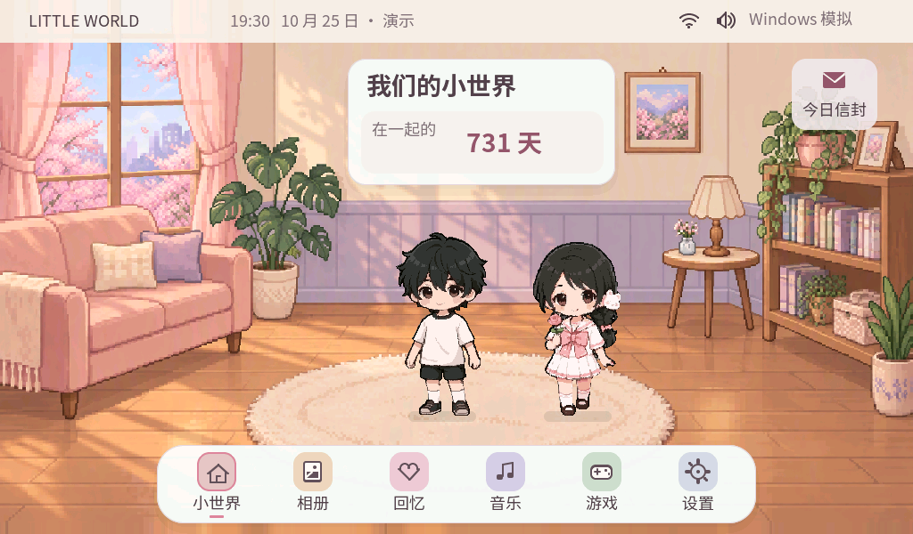
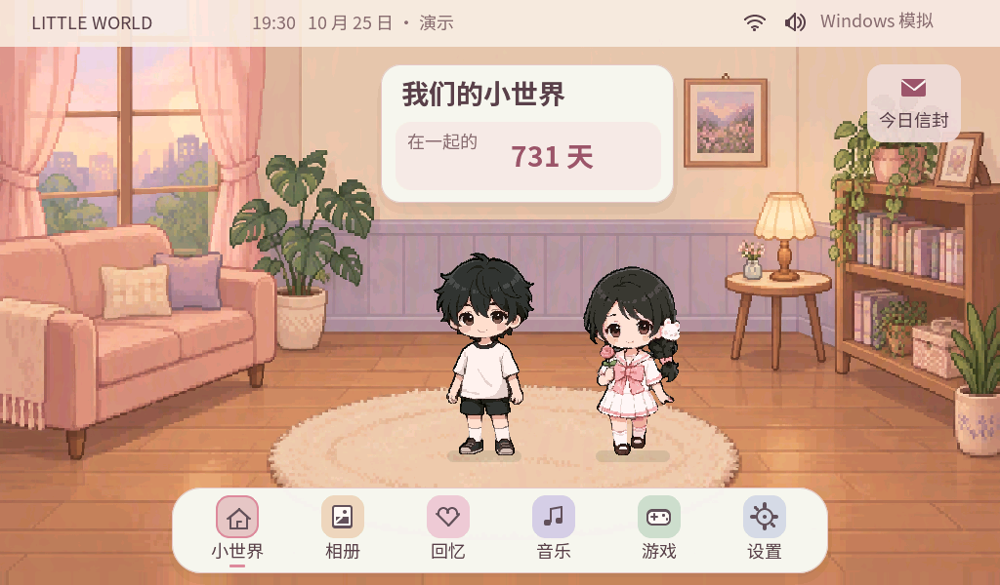
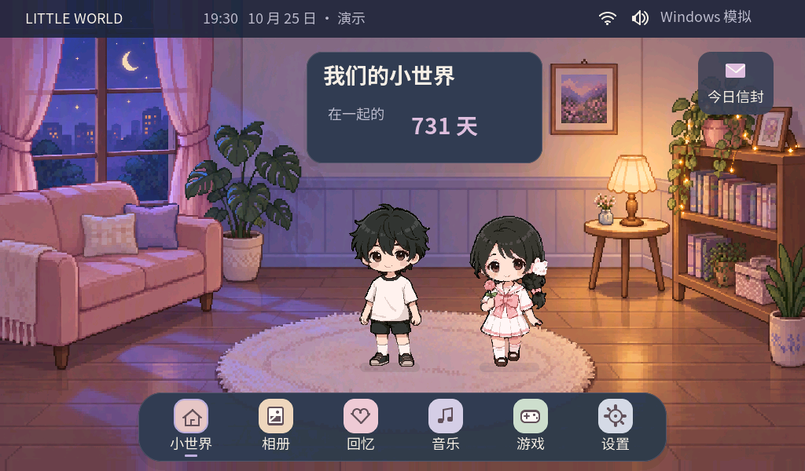
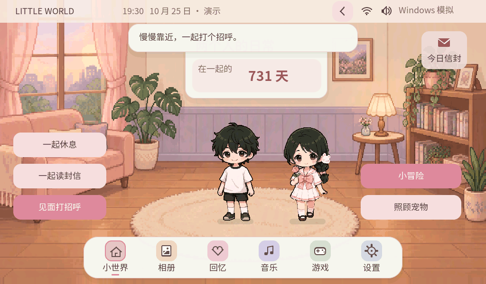
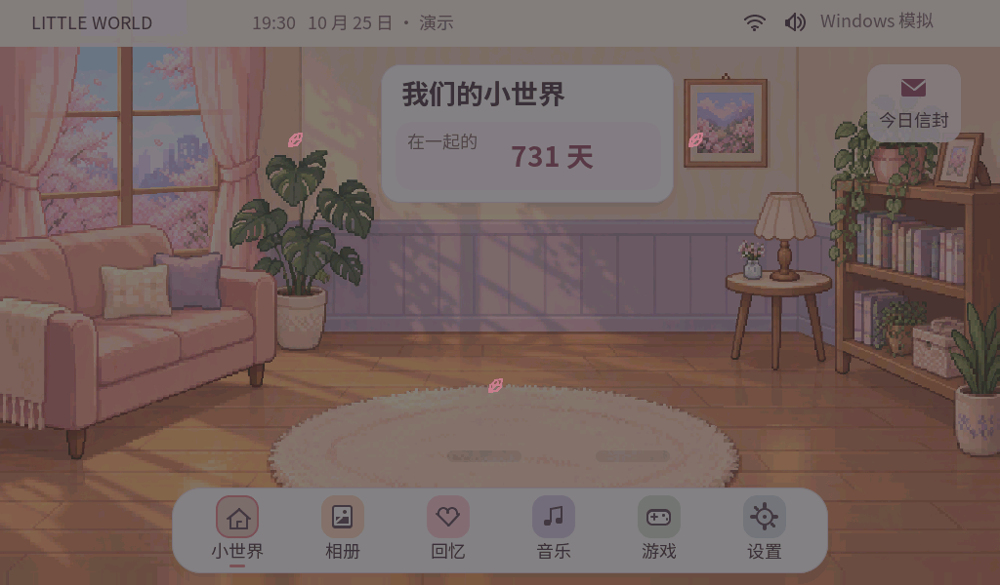
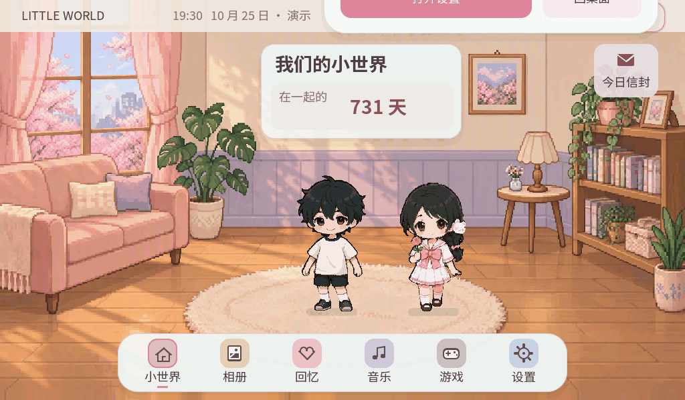
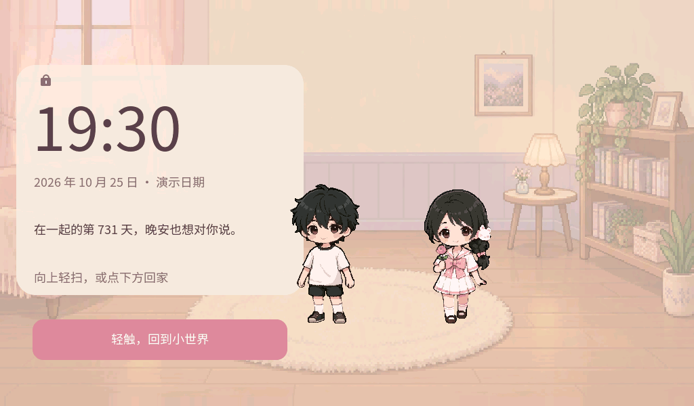
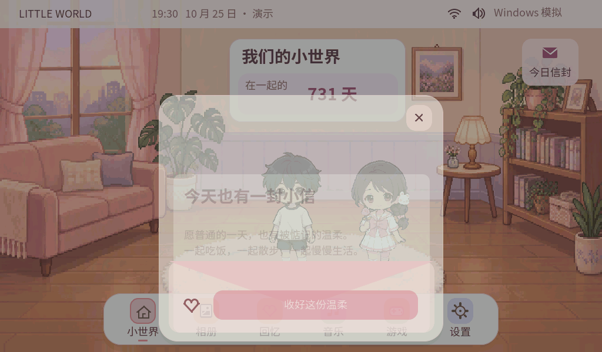

# Little World V4 · 打开这个小世界

这是可操作的 Windows LVGL 真实渲染结果。下列画面来自同一次最终回归的帧缓冲；不是 Meowa 概念图，也不是 ESP32 板测。

本轮工作区 `D:\LittleWorld-V4-Visual`，分支 [`agent/visual-v4-meowa-motion`](https://github.com/Start66613/littleworld/tree/agent/visual-v4-meowa-motion)。双击项目根目录 **Start-Visual-V4.bat**，自动准备原版千千资源并构建、打开模拟器。既有 D 盘工具链及 DesktopPet 原始资源需要保留；没有角色资源时会明确提示并降级运行。

## 三个时间的小屋

### Sakura Morning · 樱花晨光

### Strawberry Sunset · 草莓落日

继承 DSH 原房间母版，保留家具结构和细节。

### Moonlight Dream · 月光梦境

## 小世界真正动起来

这些 GIF/WebP 由连续采样的真实 LVGL 帧组成；预览末尾增加停留便于查看，不代表板上帧率。GIF 有调色板量化，对应 WebP 为无损版本。

### 两个人靠近、同时挥手、回到待机

[无损 WebP](previews/greeting.webp) · [男方呼吸](../../assets/visual-v4/characters/male/idle.gif) · [男方眨眼](../../assets/visual-v4/characters/male/blink.gif) · [男方挥手](../../assets/visual-v4/characters/male/wave.gif) · [原版千千待机](../../assets/visual-v4/characters/qianqian/original-idle.gif) · [千千挥手](../../assets/visual-v4/characters/qianqian/wave.gif)

上述单角色动画是素材预览；双人预览是实际 LVGL 播放。原版千千的既有待机、行走、睡眠等 13 组动作不被新挥手替换。

### 小屋开机

[无损 WebP](previews/boot.webp)

### 跟手下拉与上推控制中心

[无损 WebP](previews/control-center.webp) · 面板在按住时跟随指针，松手吸附；短拖取消，上推关闭。

### 上滑揭开桌面

[无损 WebP](previews/unlock.webp)

### 打开今日小信封

[无损 WebP](previews/letter.webp)

## 其他可操作页面

- [控制中心](screenshots/v4-pull-open.png)、[设置](screenshots/04-settings.png)、[三档动态设置](screenshots/25-motion-settings.png)、[主题预览](screenshots/05-themes.png)。
- [相册浏览](screenshots/13-album-viewer.png)、[本地测试照片](screenshots/26-album-local-photo.png)、[空相册](screenshots/21-album-empty.png)、[加载错误](screenshots/27-album-load-error.png)。
- [音乐盒](screenshots/29-music-simulated.png)、[纪念页](screenshots/15-anniversary.png)、[故事详情](screenshots/28-story-detail.png)、[宠物互动](screenshots/12-pet-interaction.png)。
- [小游戏与暂停](screenshots/30-game-pause.png)、[RPG 房间](screenshots/17-rpg-room.png)、[任务本](screenshots/18-rpg-journal.png)、[对话](screenshots/19-rpg-dialogue.png)、[奖励](screenshots/20-rpg-reward.png)。

这些应用继续复用已有业务和 P5 布局，接入本轮主题与动效；没有将每个页面重新画成新场景。音乐为明确标识的模拟 transport，照片为非私人技术样例，RPG A/B 仍为测试角色。

## 索引与验收边界

- [最终报告](FINAL_REPORT.md)：实际完成、未完成、编译范围和硬件限制。
- [动效验收](MOTION_ACCEPTANCE.md)、[资源与内存契约](../../docs/handoff/DSH_VISUAL_V4_RESOURCES.md)、[统一美术规范](../../ART_DIRECTION.md)。
- [67 张最终帧缓冲清单与哈希](SCREENSHOTS.json)、[验证证据](VERIFICATION.json)、[脱敏构建/测试日志](BUILD_AND_TEST_LOG.md)、[114 项素材审查](ART_AUDIT.json)。
- [全部截图](screenshots/)，另附一张明确命名的 Windows 稳定基线图用于比较。
- [原始母版与运行版](../../assets/visual-v4/scenes/)、[逐帧 PNG/时长/原始 Meowa 输出](../../assets/visual-v4/characters/)、[RGB565 和角色流式资源](../../assets/visual-v4/runtime/)、[命中区](../../assets/visual-v4/HIT_REGIONS.json)。
- [Skill 同步验证](MEOWA_SKILL_UPDATE.md)、[169 积分账单](MEOWA_BUDGET.md)、[任务 ID/输入/验收记录](MEOWA_JOBS.json)。

屏幕上的日期、731 天和小信是演示内容，不代表导入了用户私人故事。美术质量仍需用户视觉验收。未连接开发板、未刷写；离线固件尚未挂载本轮大场景与新动作文件，不能把这些 Windows 截图当成板上效果。
